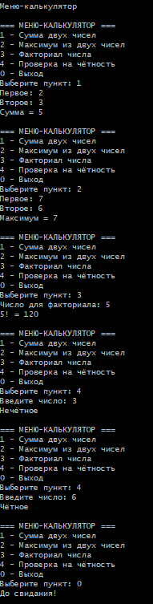
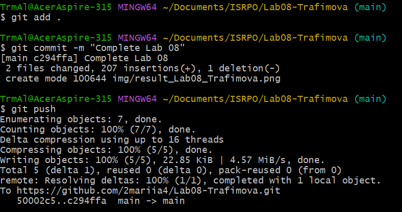

# Практическая работа №8

**ФИО:** Трафимова Мария Алексеевна
**Группа:** ИСП-242

## Что изучено

- `void`-метод просто выполняет действия и ничего не возвращает, а метод с указанным типом (например, `int`) обязан вернуть значение через `return` — это позволяет использовать результат в выражениях.
- Параметры задают «входные данные» метода: при вызове в них подставляются аргументы, поэтому один и тот же код работает с разными значениями.
- `return` сразу завершает метод и возвращает значение; в методах с типом результата он должен присутствовать на всех путях выполнения, иначе будет ошибка компиляции.

## Скриншоты

